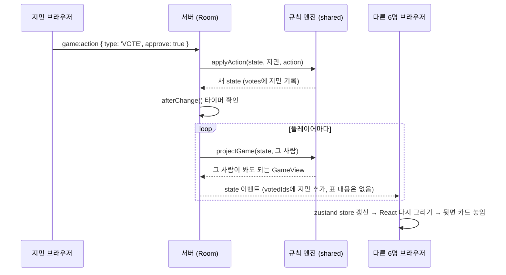
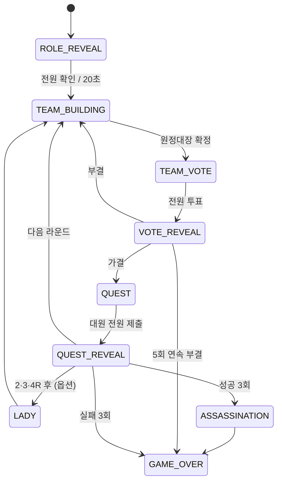

# 아발론 원탁 코드 공부 가이드 (탑다운)

> 이 문서는 **큰 그림 → 작은 부품** 순서로 내려가며 코드를 읽도록 짜여 있습니다.
> 각 단계는 먼저 **질문**을 던집니다. 바로 답을 읽지 말고, 30초만 스스로 예측해 본 뒤 펼쳐 보세요.
> 접힌 답(`▶ 답 보기`)은 GitHub나 VS Code 미리보기에서 클릭하면 열립니다.

전체 코드는 약 3,400줄입니다. 한 번에 다 읽을 필요 없고, 이 문서의 **레벨 순서**대로 따라가면 됩니다.

---

## 레벨 0. 한 문장으로

> 친구 7명이 각자 브라우저로 같은 주소에 접속하면, **노트북 한 대의 서버**가 게임을 진행하고, 각자의 화면은 그 서버가 보내 준 정보로 **3D 원탁을 그린다**.

### 🔎 질문 0
지민이 "찬성" 카드를 클릭했습니다. 0.2초 뒤, 다른 6명 화면의 테이블에 **뒷면 카드**가 하나 놓입니다.
그런데 다른 6명은 지민이 찬성을 냈는지 반대를 냈는지 **모릅니다.** 지민의 브라우저도 다른 사람의 표를 모릅니다.

**누가 진짜 표를 알고 있을까요? 그리고 왜 그 한 곳만 알아야 할까요?**

<details><summary>▶ 답 보기</summary>

**서버만** 압니다. 브라우저는 사용자가 마음대로 열어 볼 수 있는 곳이라서(F12 개발자 도구), 브라우저에 들어간 정보는 "숨긴" 것이 아닙니다.
그래서 이 프로젝트의 가장 중요한 원칙은 이것입니다.

> **판정과 비밀은 서버에, 그리기는 브라우저에.**

이 원칙 하나가 폴더 구조, 통신 방식, 테스트까지 전부 결정합니다. 아래 레벨들은 모두 이 원칙의 결과입니다.
</details>

---

## 레벨 1. 세 덩어리

```
avalon/
├─ shared/   게임 규칙 (서버와 브라우저가 같이 씀)
├─ server/   방 관리 + 통신 (노트북에서 실행)
├─ client/   화면: 3D 원탁 + 버튼 UI (브라우저에서 실행)
├─ tools/    개발 도구 (모델 압축, 테스트용 봇)
├─ specs/    기획 문서 (spec → plan → tasks)
└─ docs/     지금 읽는 문서
```

npm **workspaces**로 세 패키지를 한 저장소에 묶었습니다(루트 `package.json`의 `"workspaces"`).

### 🔎 질문 1
규칙(예: "7인 이상 4라운드는 실패 카드 2장이 있어야 실패")은 서버만 알면 됩니다. 판정은 서버가 하니까요.
**그런데 왜 규칙이 `server/`가 아니라 `shared/`에 따로 있을까요?** 브라우저는 규칙의 어떤 부분이 필요할까요?

<details><summary>▶ 답 보기</summary>

세 가지 이유가 있습니다.

1. **타입 공유**: 서버가 보내는 데이터 모양(`GameView`, `RoomView`)을 브라우저도 똑같이 알아야 합니다. `shared/src/types.ts` 하나를 양쪽이 import하면, 한쪽만 바꾸고 다른 쪽을 잊는 실수가 컴파일 단계에서 잡힙니다.
2. **화면 표시용 규칙**: 로비에서 "7인 구성 · 선 4 · 악 3"을 보여주거나, 방장이 불가능한 역할 조합을 고르면 미리 경고하는 건 브라우저가 `rolesFor`, `validateSetup`을 직접 불러서 합니다. (최종 판정은 여전히 서버가 다시 합니다.)
3. **이사 가기 쉬움**: 규칙 엔진은 네트워크도, 파일도, 시간도 모르는 **순수 함수**라서 나중에 서버를 Cloudflare 같은 다른 곳으로 옮겨도 그대로 가져갈 수 있습니다.
</details>

---

## 레벨 2. 클릭 한 번의 여행

질문 0의 "찬성 클릭"이 실제로 어떤 파일들을 거치는지 따라가 봅시다. **이 여행 하나를 이해하면 프로젝트의 70%를 이해한 것입니다.**



| 순서 | 파일 | 하는 일 |
|---|---|---|
| ① | `client/src/ui/Overlay.tsx`의 `Hand` | 찬성 버튼 `onClick` → `api.act({ type: 'VOTE', approve: true })` |
| ② | `client/src/net/socket.ts`의 `call` | `socket.emit('game:action', …, ack)`로 서버에 보내고 응답(ack)을 기다림 |
| ③ | `server/src/index.ts` | `socket.on('game:action')` → `withRoom`으로 "이 사람이 어느 방에 있나" 확인 |
| ④ | `server/src/Room.ts`의 `action` | 규칙 엔진에 넘기고, 성공하면 상태를 교체 |
| ⑤ | `shared/src/engine/apply.ts`의 `applyAction` | `case 'VOTE'`: 단계 확인 → 표 기록 → 전원이 냈으면 `VOTE_REVEAL`로 |
| ⑥ | `server/src/Room.ts`의 `afterChange` → `broadcast` | 단계가 바뀌었으면 타이머를 잡고, 모두에게 각자의 뷰를 보냄 |
| ⑦ | `shared/src/engine/project.ts`의 `projectGame` | **사람마다 다른** 뷰를 만듦. 공개 전 표 내용은 빼고 "누가 냈는지"만 |
| ⑧ | `client/src/net/socket.ts` | `socket.on('state')` → `useStore.setState({ view })` |
| ⑨ | `client/src/scene/TableObjects.tsx` | `votedIds`에 있는 사람 앞에 뒷면 카드(`Card`)를 그림 |

### 🔎 질문 2
⑤에서 엔진은 `state`를 **직접 고치지 않고** `structuredClone(prev)`로 복사한 뒤 복사본을 고쳐서 돌려줍니다. 메모리도 더 쓰는데, 왜 굳이 복사할까요?
힌트: 액션이 **실패**하는 경우를 떠올려 보세요. (예: 선의 세력이 실패 카드를 내려고 할 때)

<details><summary>▶ 답 보기</summary>

`applyAction`은 중간에 `return fail('…')`로 끝날 수 있습니다. 원본을 직접 고치고 있었다면, 실패하기 직전까지 고친 내용이 **원본에 반쯤 남아** 버립니다.
복사본을 고치면 실패할 때 복사본만 버리면 되니까 원본은 늘 멀쩡합니다. 이런 함수를 **순수 함수(pure function)** 라고 하고, 같은 입력이면 항상 같은 출력이 나와서 **테스트하기가 아주 쉽습니다.** 레벨 6의 테스트 600판 시뮬레이션이 가능한 이유입니다.

React의 `setState`, Redux의 reducer도 같은 아이디어입니다. 지금 이 패턴을 익혀 두면 다른 프로젝트에서 계속 만납니다.
</details>

---

## 레벨 3. 패키지 안의 지도

### shared/ — 규칙 엔진 (네트워크·화면 모름)

| 파일 | 줄 | 역할 | 먼저 볼 부분 |
|---|---|---|---|
| `types.ts` | 113 | 모든 데이터 모양 | `GameState`(서버 전용 전체 정보) vs `GameView`(한 사람용) 비교 |
| `constants.ts` | 76 | 인원별 표, 역할 이름·행동요령, 타이머 | `QUEST_SIZES`, `failsNeeded` |
| `engine/setup.ts` | 65 | 역할 만들기·섞기·첫 원정대장 | `rolesFor` → `shuffle` → `createGame` |
| `engine/apply.ts` | 165 | 행동 하나 처리 (상태 머신) | `switch (action.type)` 전체 |
| `engine/project.ts` | 69 | 사람별로 보여줄 정보 걸러내기 | `knowledgeFor`(누가 누구를 아는지) |
| `characters.ts` | 20 | 캐릭터 모델 9종, 자리 색 | — |
| `engine.test.ts` | 292 | 규칙 테스트 20개 | `정보 누출` describe |

### server/ — 방과 통신

| 파일 | 줄 | 역할 | 먼저 볼 부분 |
|---|---|---|---|
| `index.ts` | 150 | Express(정적 파일) + Socket.io 이벤트 연결 | `io.on('connection')` 안의 `socket.on(…)` 목록 |
| `Room.ts` | 236 | 방 하나: 멤버, 게임 상태, 타이머, 재접속 | `join` → `action` → `afterChange` → `viewFor` |
| `integration.test.ts` | 137 | 진짜 서버에 봇 5명을 붙여 한 판 | 재접속 부분 |

### client/ — 화면

| 폴더/파일 | 역할 |
|---|---|
| `main.tsx` | 앱 시작점. 방에 들어갔으면 `Game`, 아니면 `Entry` |
| `store.ts` | **zustand** 전역 상태: 서버가 보낸 `view`, 시선, 토스트, `isMyTurn` |
| `net/socket.ts` | 서버와의 모든 통신 (`api.create/join/act…`), 재접속 토큰 저장 |
| `screens/` | `Entry`(방 만들기·참가), `Game`(3D + UI 겹치기, 로딩) |
| `scene/` | **3D**: `GameScene`(조립) · `Room`(돌방·원탁·의자) · `Seat`(자리 하나) · `Character`(KayKit 모델) · `TableObjects`(카드·토큰) · `CameraRig`(1인칭 카메라) · `layout.ts`(원탁 좌표 수학) |
| `ui/` | **2D 위층**: `Overlay`(상태 바·손패·역할 카드·결과…) · `SeatMap`(좌석 지도) · `sound.ts`(효과음) · `game.css` |
| `preview.tsx` | 캐릭터 미리보기 페이지(`/preview.html`) |

---

## 레벨 4. 핵심 개념 다섯 개

### 4-1. 상태 머신: 게임은 "지금 어느 단계인가"가 전부다



`apply.ts`의 거의 모든 `case`는 첫 줄이 `if (s.phase !== '…') return fail(…)`입니다.

#### 🔎 질문 4-1
`ADVANCE`라는 행동은 플레이어가 아니라 **서버 타이머만** 보낼 수 있습니다(`actorId === null`). 만약 플레이어도 `ADVANCE`를 보낼 수 있다면 어떤 장난이 가능할까요?

<details><summary>▶ 답 보기</summary>

투표 공개 화면(`VOTE_REVEAL`)이나 원정 카드 공개 화면을 **남들이 보기 전에 넘겨 버릴 수** 있습니다. 결과를 숨기고 싶은 악의 세력에게 유리하겠죠.
그래서 `applyAction` 맨 위에서 "ADVANCE는 actorId가 null일 때만"을 검사하고, 서버의 `index.ts`도 `p.type !== 'ADVANCE'`인 행동만 엔진에 넘깁니다. **이중 잠금**입니다.
</details>

### 4-2. 프로젝션(projection): 같은 게임, 사람마다 다른 화면

서버는 상태가 바뀔 때마다 **플레이어 수만큼** `projectGame(state, 그 사람)`을 호출해 각자에게 따로 보냅니다(`Room.broadcast`).

| 정보 | 본인 | 다른 사람 |
|---|---|---|
| 내 역할 | 보임 | 안 보임 (게임 끝날 때 공개) |
| 멀린이 아는 악의 세력 | 멀린만 | — |
| 공개 전 찬반 표 | 내 표만 | "냈다"는 사실만 (`votedIds`) |
| 원정 카드 | 누가 냈는지는 **영원히** 비공개 | 섞인 결과만 |

#### 🔎 질문 4-2 (실제로 있었던 버그)
처음 버전에서는 원정이 끝나는 순간 서버가 `questReveal`(섞인 카드 3장)과 `questResults`(이번 원정 성공/실패)를 **한꺼번에** 보냈습니다. 화면은 카드를 1.1초 간격으로 한 장씩 뒤집는 애니메이션을 했고요.
사용자가 "세 번째 카드가 나오기 전에 이미 실패라고 나와 있다"고 알려 줬습니다. **왜 그랬을까요? 그리고 화면 애니메이션만 고치면 충분할까요?**

<details><summary>▶ 답 보기</summary>

라운드 보드는 `questResults`를 보고 마커를 놓는데, 그 값이 이미 와 있었으니 카드보다 마커가 먼저 놓였습니다.
화면만 고치면 **보이지는 않지만 데이터는 브라우저에 이미 있는** 상태가 됩니다(F12로 보면 결과가 보임). 질문 0의 원칙을 어긴 셈입니다.

그래서 이렇게 고쳤습니다.
- 서버(`Room.afterChange`)가 타이머로 카드를 **한 장씩** 보낸다 (`questShown` 증가).
- `projectGame(s, id, questShown)`은 카드가 다 나오기 전까지 이번 결과를 `questResults`와 `history`에서 **빼고** 보낸다.
- 테스트 `원정 결과 공개 순서`가 이걸 지킨다.

> 교훈: **"화면에 안 보이게"와 "데이터를 안 보내기"는 다르다.**
</details>

### 4-3. 시간은 서버가 가진다

20초 역할 확인, 투표 공개 4초, 원정 카드 한 장씩 공개는 모두 `Room.afterChange`가 `setTimeout`으로 관리합니다. 브라우저는 서버가 알려 준 남은 시간(`timerMs`)을 **표시만** 합니다(`Overlay`의 `Countdown`).

#### 🔎 질문 4-3 (실제로 있었던 버그)
`afterChange`는 원래 **모든 행동 뒤에** 타이머를 지우고 새로 잡았습니다. 그러다 "20초가 지나도 역할 카드를 못 읽은 사람은 나중에 확인을 누를 수 있게" 기능을 넣었더니 문제가 생겼습니다.
원정 카드를 한 장씩 공개하는 도중에 누군가 늦게 "역할 확인"을 누르면 어떻게 될까요?

<details><summary>▶ 답 보기</summary>

늦은 확인도 "행동"이라서 `afterChange`가 불리고 → 공개 타이머가 지워졌다가 → **처음부터 다시** 시작됩니다. 카드가 다시 0장부터 뒤집히는 거죠.

해결: 단계를 나타내는 열쇠(`phaseKey` = 단계·라운드·시도·기록 수)를 만들어, **열쇠가 바뀔 때만** 타이머를 다시 잡습니다. 같은 단계 안의 행동이면 화면만 갱신합니다.

> 교훈: 기능 A(늦은 확인)를 넣었는데 기능 B(타이머)가 깨지는 일은 아주 흔합니다. 그래서 테스트가 필요합니다.
</details>

### 4-4. 실시간 통신: Socket.io

| 개념 | 이 프로젝트에서 |
|---|---|
| **이벤트** | `room:create`, `room:join`, `room:resume`, `game:action`, `gaze`(보내기) / `state`, `gaze`, `kicked`(받기) |
| **ack(응답 콜백)** | 행동마다 서버가 `{ ok: true }` 또는 `{ ok: false, error }`를 돌려줌 → 실패하면 토스트로 이유 표시 (`socket.ts`의 `run`) |
| **스냅샷 방식** | 바뀐 부분만이 아니라 **매번 전체 뷰**를 보냄. 몇 KB라서 충분히 가볍고, 재접속하면 스냅샷 하나로 바로 복구됨 |
| **volatile** | 시선(`gaze`)은 하나쯤 잃어버려도 되니 `volatile`로 보냄. 게임 상태와 분리 |

#### 🔎 질문 4-4
시선 정보는 초당 최대 10번 보냅니다. 서버는 이걸 게임 상태(`GameState`)에 저장하지 않고 바로 다른 사람들에게 넘기기만 합니다(`index.ts`의 `socket.on('gaze')`). **왜 저장하지 않을까요?**

<details><summary>▶ 답 보기</summary>

- 비밀이 아니라서 서버가 판정할 필요가 없습니다.
- 저장하면 상태가 바뀔 때마다 전체 스냅샷을 다시 보내야 해서, 초당 10번 × 10명 = 초당 100번 스냅샷이 쏟아집니다.
- 지난 시선은 쓸모가 없습니다. 최신 값만 중요하죠.

자주 바뀌고, 비밀이 아니고, 잃어버려도 되는 데이터는 **상태와 분리된 가벼운 채널**로 보내는 게 실시간 게임의 기본기입니다.
</details>

### 4-5. 3D: React Three Fiber

three.js를 React 컴포넌트처럼 쓰게 해 주는 라이브러리가 **@react-three/fiber(R3F)** 이고, 자주 쓰는 도우미 모음이 **@react-three/drei** 입니다.

```tsx
<Canvas>                       {/* GameScene.tsx */}
  <CameraRig />                {/* 내 자리 눈높이에 고정, 드래그로 회전 */}
  <Room />                     {/* 바닥·벽·횃불·원탁 */}
  <Seat ... />                 {/* × 사람 수: 의자 + Character + 이름표(Html) */}
  <TableObjects ... />         {/* 왕관·토큰·카드·라운드 보드 */}
</Canvas>
```

알아 둘 아이디어 네 가지:

1. **내가 항상 아래**: `layout.ts`의 `seatAngle(seat, n, mySeat)`는 내 자리를 카메라 쪽(+Z)에 두도록 모든 좌석을 돌립니다. 그래서 사람마다 원탁이 다르게 돌아가 보이지만, 서로의 상대 위치는 같습니다.
2. **고개 돌리기**: KayKit 모델은 모두 `head`라는 뼈가 있습니다. `Character.tsx`의 `useFrame`에서 애니메이션(앉은 자세)을 먼저 적용한 **다음에** 머리 뼈를 추가로 돌립니다. 순서가 반대면 애니메이션이 덮어써 버립니다.
3. **부드러운 이동**: `TableObjects.tsx`의 `Glide`는 매 프레임 목표 위치로 조금씩 다가갑니다(`lerp`). 카드가 "툭" 나타나지 않고 떨어지며 뒤집히는 이유입니다.
4. **3D 위의 HTML**: 이름표는 drei의 `<Html>`로 3D 좌표에 붙인 진짜 HTML입니다. 그래서 CSS로 꾸미고 클릭도 받을 수 있습니다.

#### 🔎 질문 4-5
`CameraRig.tsx`의 `drag.moved`는 왜 있을까요? 캐릭터를 클릭해서 원정대에 넣는 기능과 어떤 관계가 있을까요?

<details><summary>▶ 답 보기</summary>

화면을 드래그해서 둘러보다가 손을 뗀 곳에 캐릭터가 있으면, 브라우저는 그것도 "클릭"으로 처리합니다. 둘러보려다 원정대원을 넣어 버리는 사고가 납니다.
그래서 누를 때부터 뗄 때까지 움직인 거리를 재고, 6px보다 많이 움직였으면 클릭을 무시합니다(`Seat.tsx`의 `click`).
</details>

---

## 레벨 5. 실행과 배포의 흐름

```
개발 (npm run dev)
  브라우저 ─▶ Vite :5180 ─(화면 파일, 바로 새로고침)
                └─ /socket.io 만 프록시 ─▶ 서버 :3000 (tsx watch: 저장하면 재시작)

배포 (npm run build → npm start)
  client/dist 생성 → 서버 :3000 하나가 화면 파일 + 소켓을 모두 담당
  cloudflared 터널 ─▶ https://….trycloudflare.com ─▶ 노트북 :3000
```

#### 🔎 질문 5
배포 모드에서 화면 코드를 고친 뒤 `npm start`만 다시 하면 고친 내용이 반영될까요?

<details><summary>▶ 답 보기</summary>

**안 됩니다.** 서버는 `client/dist`에 있는, **빌드해 둔** 파일을 내보냅니다. 화면 코드를 고쳤다면 `npm run build`를 먼저 해야 `dist`가 새로 만들어집니다. 서버 코드(`server/`, `shared/`)를 고쳤을 때는 재시작만 하면 됩니다(tsx가 TypeScript를 바로 실행).
</details>

---

## 레벨 6. 테스트: 바이브코딩의 안전벨트

| 테스트 | 무엇을 지키나 |
|---|---|
| 규칙 단위 테스트 (`shared/src/engine.test.ts`) | 인원별 구성, 아는 정보, 투표·원정·암살·호수의 여인 분기 |
| **정보 누출 테스트** | 진행 중 뷰에 다른 사람 역할·공개 전 표·카드 주인이 들어 있지 않은지 |
| **무작위 시뮬레이션 600판** | 5~10인, 옵션 무작위, 봇이 아무렇게나 둬도 예외 없이 끝나는지 |
| 서버 통합 테스트 (`server/src/integration.test.ts`) | 진짜 서버에 봇 5명: 입장 → 재접속 → 닉네임으로 복귀 → 완주 → 다시 하기 |

```bash
npm test
```

#### 🔎 질문 6
AI가 짠 코드를 고칠 때, 사람이 매번 한 판씩 직접 해 보는 대신 테스트가 특히 도움이 되는 이유는 뭘까요? 4-3의 버그를 떠올려 보세요.

<details><summary>▶ 답 보기</summary>

AI는 요청한 기능은 잘 만들지만, **그 기능이 다른 곳에 주는 영향**은 놓치기 쉽습니다. 사람이 직접 해 보면 원정 공개 도중에 누가 늦게 확인을 누르는 상황 같은 건 거의 재현되지 않습니다.
테스트는 "예전에 되던 것이 여전히 되는가"를 몇 초 만에 다시 확인해 줍니다. 바이브코딩일수록 **기능을 하나 추가할 때마다 테스트를 하나 추가**하는 습관이 중요합니다.
</details>

---

## 부록 A. 이번 프로젝트에서 실제로 만난 버그들

공부하기 가장 좋은 재료는 실제 버그입니다. 원인을 먼저 추측해 보세요.

| 증상 | 원인 | 배운 점 |
|---|---|---|
| 모델 압축 후 캐릭터가 안 뜸 (`reading 'bufferView'`) | 안 쓰는 애니메이션을 지우면서, **남긴 애니메이션과 같이 쓰던** 시간 데이터까지 지움 (`tools/optimize-models.mjs`) | 공유 자원은 직접 지우지 말고 "아무도 안 쓰는 것만 정리"하는 도구(prune)에 맡기기 |
| 갑자기 화면이 멈춤 (`Invalid hook call`) | 개발 서버가 새 라이브러리를 발견해 다시 묶는 도중 **React가 두 벌** 섞임 | `vite.config.ts`의 `optimizeDeps.include`로 미리 묶기 |
| 방 설정 스위치를 눌러도 반응 없음 | 유력한 원인: 부모 컴포넌트 **안에서** 정의한 `Toggle`이 렌더링마다 새 컴포넌트로 바뀌어 클릭 도중 다시 만들어짐. (숨긴 체크박스를 버튼으로 바꾸는 수정도 같이 해서 둘 중 무엇이 결정적이었는지는 확인하지 않음) | 컴포넌트는 바깥(모듈 최상위)에 정의하기. 고칠 때는 한 번에 하나씩 바꿔야 원인을 알 수 있음 |
| 마지막 원정 카드 전에 결과가 보임 | 4-2 참고 | 안 보이게 ≠ 안 보내기 |
| 원정 공개가 처음부터 다시 시작될 수 있음 | 4-3 참고 | 기능 추가가 다른 기능을 깨뜨림 → 테스트 |
| 브라우저를 닫으면 게임에 못 돌아옴 | 재접속 토큰을 `sessionStorage`(탭이 닫히면 사라짐)에만 저장 | 같은 닉네임으로 빈 자리를 되찾는 길을 추가 (`Room.join`) |
| 터널이 안 열림 | 학교 와이파이가 `trycloudflare.com` 주소를 차단 | 코드 문제가 아닐 수도 있다: 같은 서버 IP에 다른 이름으로 접속해 비교하며 원인 좁히기 |

---

## 부록 B. 추천 읽기 순서 (약 2~3시간)

1. `shared/src/types.ts`: 데이터 모양부터. `GameState`와 `GameView`의 차이를 표로 직접 정리해 보기
2. `shared/src/engine/setup.ts`: 역할이 어떻게 섞이는지
3. `shared/src/engine/apply.ts`: `switch`를 위에서 아래로. 각 `case`의 `fail` 조건을 소리 내어 읽기
4. `shared/src/engine/project.ts`: 비밀이 어디서 걸러지는지
5. `shared/src/engine.test.ts`: 위 세 파일이 어떻게 검증되는지
6. `server/src/Room.ts`: `join` → `action` → `afterChange` → `viewFor`
7. `server/src/index.ts`: 이벤트 이름 목록만 훑기
8. `client/src/net/socket.ts` → `store.ts`: 서버 데이터가 화면 상태가 되기까지
9. `client/src/ui/Overlay.tsx`: `statusOf` 함수 하나만 먼저 (단계별 문구)
10. `client/src/scene/GameScene.tsx` → `layout.ts` → `Seat.tsx` → `TableObjects.tsx`
11. 마지막으로 `Character.tsx`의 `useFrame` (고개 돌리기)

### 직접 해 보기 (작은 과제)

- **쉬움**: 투표 공개 시간을 4초에서 6초로 바꿔 보세요. 어느 파일 한 줄만 바꾸면 될까요? (`constants.ts`의 `TIMINGS`)
- **보통**: 로비에서 방장이 아닌 사람에게 "방장: ○○" 문구를 보여 주세요. (`Overlay.tsx`의 `LobbyPanel`)
- **도전**: 새 규칙 테스트를 하나 써 보세요. "8인 게임 1라운드 원정대는 3명이다"를 `engine.test.ts`에 추가하고 `npm test`로 확인.

---

## 부록 C. 용어 정리

| 용어 | 뜻 |
|---|---|
| 모노레포 / workspaces | 여러 패키지(shared, server, client)를 한 저장소에서 관리 |
| 순수 함수 | 같은 입력 → 같은 출력, 바깥 세상(파일·네트워크·시간)을 건드리지 않음 |
| 상태 머신 | "지금 단계"와 "단계 사이의 전이 규칙"으로 동작을 표현 |
| 프로젝션 | 전체 상태에서 한 사람에게 보여 줄 부분만 뽑아낸 것 |
| ack | Socket.io에서 요청에 대한 응답 콜백 |
| volatile | 잃어버려도 되는 메시지 (최신 값만 중요할 때) |
| R3F | React Three Fiber, three.js를 React로 쓰기 |
| glTF / glb | 3D 모델 파일 형식 (웹 표준) |
| 빠른 터널 | 계정 없이 노트북 서버에 임시 외부 주소를 붙여 주는 Cloudflare 기능 |
